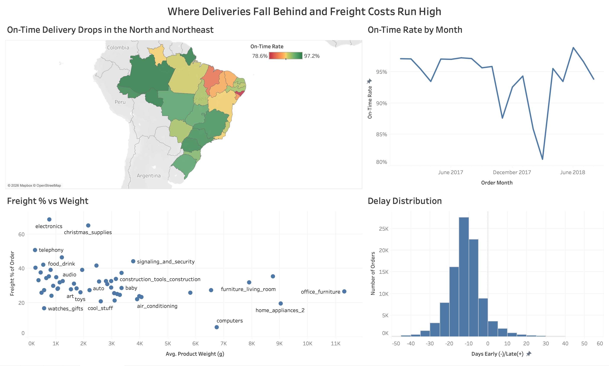

# Delivery Performance Analysis

I worked in an air cargo warehouse where everything ran on flight schedules, so I wanted to look at delivery performance with real data and figure out what actually makes orders show up late.

**Question:** What drives late deliveries, and what do they cost?

**Tools:** Python (pandas), SQL (MySQL, then BigQuery), Excel, Tableau Public

## The Data

Olist Brazilian E-Commerce dataset from Kaggle. About 100,000 real orders from 2016 to 2018 spread across nine tables. I used six of them: orders, order items, products, sellers, customers, and the category translation table.

The raw CSVs aren't in this repo because of their size. Download them [here](https://www.kaggle.com/datasets/olistbr/brazilian-ecommerce) and put them in the `data` folder to run the notebooks.

## How I Cleaned It

- Parsed the five date columns, which all came in as text.
- Kept only delivered orders with an actual delivery date. That took it from 99,441 orders to 96,470. The 2,971 I dropped were canceled, unavailable, still in transit, or missing a delivery date.
- The items table has 112,650 rows for about 98,000 orders because some orders have more than one item. If you join that straight onto orders, multi-item orders get counted more than once and the freight totals come out inflated. So I rolled items up to one row per order first, then joined.
- Added an assert after the join to make sure every order_id was still unique.
- Translated the Portuguese category names using the lookup table. 610 products had no category at all, so those are labeled "unknown".
- Built the metrics: delivery days, promised days, delay days, on time (arrived on or before the promised calendar date), freight as a % of order value, and whether the order crossed state lines.

The guide I was following said around 600 products were missing weight and dimensions. When I checked, only 2 were missing weight. The 610 nulls were in the category name.

## What I Found

1. 93.2% of orders arrived on time. The average order took 12.1 days but was promised in 23.4, so most orders came in way ahead of the promise.
2. Late orders are mostly in the north and northeast. Alagoas was on time 78.6% of the time and Maranhão 82.6%, compared to 95.5% in São Paulo, which also had the most orders by far.
3. Cross-state orders took 14.7 days on average vs 7.5 in-state, and freight was 34.8% of the order value vs 23.8%.
4. Electronics averaged 0.77 kg but freight was 68.7% of the order value. Telephony was 0.26 kg and 50.8%. Light, cheap items pay the most in freight relative to what they cost.
5. Orders promised in under 10 days had the lowest on-time rate (89.5%). Orders promised 30+ days out had the highest (95.0%) and still showed up almost 19 days early on average.
6. The worst seller was on time 69.4% of the time, and most of the 20 worst sellers were in São Paulo, even though SP has one of the best on-time rates overall.
7. On-time dropped to 87.6% in November 2017, the busiest month in the data (Black Friday). Orders jumped about 63% from October. It dropped again to 85.9% in February 2018 and 81.0% in March, but order volume was about the same as January, so volume doesn't explain that one.

## What I'd Recommend

1. Add a few days of buffer to short delivery promises, especially for north and northeast routes.
2. Shorten the long promises. If a customer is told 30 days and it shows up in 11, a more accurate date could help sales.
3. Look at how freight is priced on light, low value items like electronics and telephony.
4. Audit sellers below 85% on time instead of judging performance by state.

## What I Couldn't Answer

- There's no carrier info, so I can't tell whether a late order was the seller's fault or the carrier's.
- Freight here is what the customer paid, not what shipping actually cost, so freight % is a share of revenue, not margin.
- For orders with more than one item, I used the first item's seller and product.
- This is Brazilian geography and infrastructure, so the distance findings don't carry over to the US.

## Problems I Ran Into

**Python**
- pip wouldn't install pandas (externally-managed-environment error). Set up a virtual environment and installed it there.
- Named my notebook `.ipnyb` instead of `.ipynb` and VS Code didn't recognize it.
- Got `NameError: name 'd' is not defined` in the cleaning notebook. Didn't realize notebooks don't share variables, so I had to load the CSVs again at the top.

**SQL**
- Started with MySQL. The server wouldn't start on its own and I needed help getting it running and getting the CSV loaded, since MySQL blocks loading local files by default.
- My first query returned nothing. `Analysis.sql` still had the `CREATE TABLE` from setup at the top, the table already existed, so it errored out before it got to my SELECT.
- The VS Code MySQL extension kept not showing results, so I switched to BigQuery and ran everything in the web console. Row count matched, 96,470.

**Excel**
- The translation CSV opened as a separate workbook, so my lookup was pointing at an outside file and Excel kept asking me to find it. Copied it into a sheet in the same workbook.
- My lookup returned 0 at first, then "unknown" on every row. It was pointing at the wrong sheet. Once I fixed that, the first row came back `housewares`, same as the pandas output.
- Couldn't put the purchase timestamp in the pivot columns ("more than 16,384 items") since every timestamp is unique. Added an `order_month` column with `=TEXT(D2,"yyyy-mm")` and updated the pivot's data source.
- Couldn't find Group in the right-click menu on Mac. It was under PivotTable Analyze, then Group Field.

**Tableau**
- Tableau Desktop said I needed a newer version, so I used Tableau Public instead.
- Took me a while to find "Number of Records".
- Putting `order_id` in Rows hit the 1,000 mark limit because it tried to plot every order. Made a `COUNT([Order Id])` calculated field instead.
- Set the category filter to a max of 100 orders by mistake, which only kept the small categories. Changed it to at least 100.
- Couldn't find Edit Axis on the histogram because the bin field was discrete. Switched it to continuous, then set the range to -40 to 40 so a few extreme outliers (one order 147 days early, one 188 days late) didn't squash the chart.
- After I reorganized the repo into folders, the Tableau workbook couldn't find its data and threw an extract error. Removed the extract and pointed the connection to `data/delivery_clean.csv`.
- My first histogram axis label had early and late backwards. Fixed it before publishing.

## Files

| File | What it is |
|---|---|
| `notebooks/01_profile_data.ipynb` | First look at the raw tables: row counts, nulls, order statuses |
| `notebooks/02_clean_and_join.ipynb` | Cleaning, joining, and building the metrics. Outputs `data/delivery_clean.csv` |
| `sql/analysis_queries.sql` | The six analysis queries, run in BigQuery |
| `excel/delivery_performance_analysis.xlsx` | Category lookup and pivot tables |
| `images/dashboard.png` | Tableau dashboard |
| `data/README.md` | Where to get the data |
| `requirements.txt` | Python packages |

To run the notebooks: `pip install -r requirements.txt`, add the CSVs to `data/`, then run the notebooks in order.
